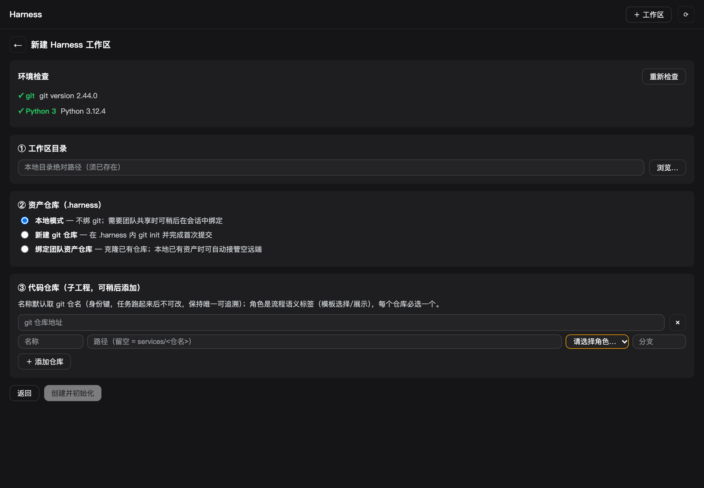
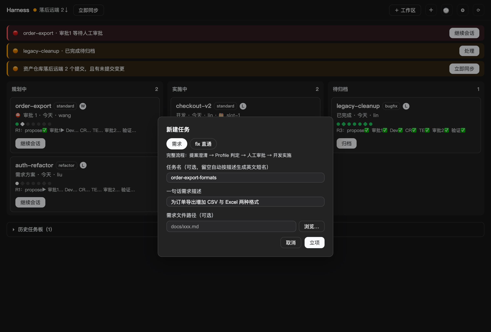
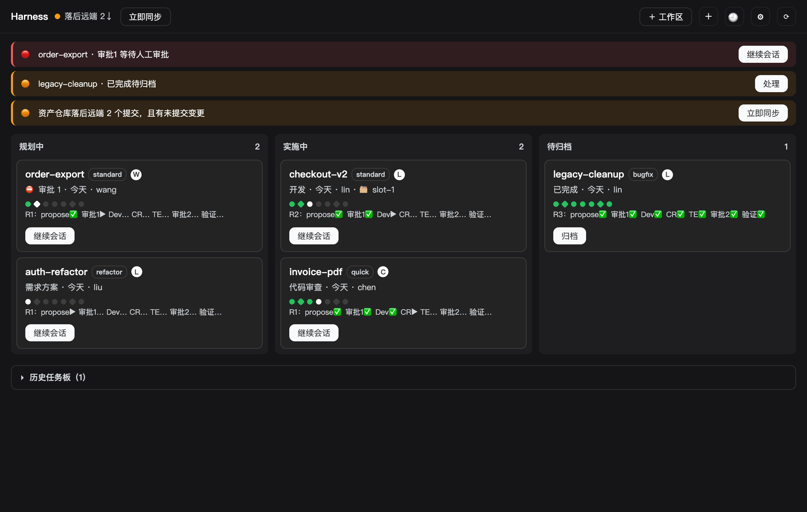

# Harness Kit

**Turn AI coding from a personal habit into a team process.**

Harness Kit is a DeepSeek Harness plugin that gives AI work a repeatable engineering workflow: fixed
roles for analysis, design, implementation, review and testing; human approval gates; and a git
asset repository that keeps every round's output. **AI executes, humans gate, assets accumulate.**

Used alone, it is your project memory and a second pair of eyes. Used by a team, it is a shared
process and shared assets.

`7 roles` · `4 flow profiles` · `4 daily commands` · `zero runtime dependencies` · `local-first`

English | [简体中文](README.zh-CN.md)

> A harness is a set of restraints. The stronger the model, the more it needs a stable process
> instead of reinventing the approach on every task.

---

## Install in DSH

Harness Kit is a **DSH plugin bundle**, not a standalone app. Install it into DeepSeek Harness
(DSH 0.2.x with the Web client; `git` and `Python 3` are checked by the workspace wizard).

### In the app (recommended)

1. Open **DSH → Plugins → Add plugin**
2. Enter `dsh-harness-kit@0.3.2`
3. Install, then enable the bundle. If DSH asks to restart, fully quit and reopen DSH
4. Open **Harness Kit** in the sidebar → **＋ Workspace** → create and initialize a workspace

### Command line

```sh
dsh plugin --profile desktop add dsh-harness-kit@0.3.2
```

Quit DSH Desktop first; replace `desktop` with your profile name for other profiles.

### From a checkout

```sh
dsh plugin --profile desktop add /absolute/path/HarnessKit
```

After installation the Harness Kit panel appears in the sidebar. The panel checks npm for a newer
version once an hour and shows a top-bar prompt; updating remains a manual action in Plugins. You
still need to create a workspace before using tasks, flows or approvals.

Requirements: DSH 0.2.x with the Web client (Desktop or `dsh web`), `git`, `Python 3` (the wizard
checks both), and a DSH session working directory to use as the Harness workspace.

---

## It makes your project legible to AI first

Harness Kit is not only a workflow. After the workspace is created, **Start initialization
orchestration** probes the registered source repositories and fills in the project knowledge AI
would otherwise rediscover every time:

- a root `AGENTS.md`; existing `CLAUDE.md` is left untouched and also read by DSH; its source map is updated when repositories are added (marker block only, manual content preserved; legacy generated files get markers added automatically)
- per-repository `AGENTS.md` (or an existing `CLAUDE.md`) and `<repo>/.harness/build.json`
- `docs/CODE_STANDARDS.md` (standard/full) and module-level `AGENTS.md` (full only)
- `codebase-guide/`: workspace architecture skeleton; the sub-project map is maintained by init, prose is filled in on demand
- per-repository `.codegraph/` (optional): class, method and call-chain indexes
- `.harness/scripts`, `rules`, `templates`: board, health checks, spec lint and coding baselines

Initialization comes in three tiers: `minimal` (AGENTS + build), `standard` (+ coding rules) and
`full` (+ module docs). Dedicated templates cover Java Maven / Gradle, .NET, Vue / uni-app, Node (React / Next / Nest / Express), Go, Python and Rust. Unsupported stacks use a clearly marked generic template with a deliberately small footprint. You confirm the plan before anything is written; existing files are skipped and
`build.json` only gains missing keys and never overwrites custom values. CodeGraph is not installed globally by default; you are asked
whether to install it or skip.

---

## Three steps in the UI (no commands to memorize)

### 1. Open the sidebar and create a workspace

**Harness Kit → ＋ Workspace → New workspace**:

- pick a local directory (it can be empty)
- choose the asset repository: local, a new git repository, or an existing team repository
- register source repositories (URL, role and branch are required), or add them later
- click **Create and initialize**

The wizard runs an **environment check** first: if `git` or `Python 3` is missing, it shows the
install command for your platform instead of failing after submission. Initialization runs in the
background, survives a page refresh, and reports back in the panel; then **Start initialization
orchestration** probes the repositories and generates the docs and indexes described above.



### 2. Click ＋ to create a task

- choose **Requirement** or **Quick fix**
- write one sentence; the task name can stay empty and is generated from the description
- optionally attach multiple reference materials: workspace files, images, whole prototype folders, or uploads/drag-and-drop from this machine. They are copied into the task `inputs/` with an index, and the PM reads the index and inspects each image
- optionally choose a **development base** per repository; Harness Kit creates `feat/harness-<task>` from it and uses the same branch as the analysis base and archive merge target

Creating the task opens a dedicated session: requirement mode starts from the proposal, fix mode
starts from the defect document and the quality gate.



### 3. Work from the panel

- task cards move between **Planning / Implementing / To archive**
- **Needs you** lists pending approvals, archives, sync problems and workspace branch decisions
- **Pull remote** only fetches; dirty asset changes are autostashed and restored. **Commit & sync**
  previews the changed files first, lets you select what to commit, then commits and pushes
- **Continue session** jumps to the task session; after an approval, the host advances the next
  phase automatically (set `autoAdvance: false` in `.harness/kit.json` to disable)
- archive finished work into the collapsible history board
- 🕘 team activity shows who archived what and when
- ⚙ configuration edits source branches, auto-sync and team/per-machine model mappings



> The task-dialog image is an illustration of the current fields; the other screenshots use a sample
> workspace (`acme-platform`), not real project data.

> **Approvals are written by a human; the panel only reminds.** Approval 1 is recorded in
> `proposal.md`, the quality-gate decision in `bugfix.md`. That is deliberate: it keeps approvals
> from becoming a button-click ritual.
>
> The panel covers daily work. Asset rebinding, deleting a source repository and batch operations
> stay in the commands below.

---

## How it differs from personal vibe coding

| | Personal vibe coding | Harness Kit |
|---|---|---|
| Context | Lives in one session and disappears | Files under `.harness/`, diffable, committable, handover-ready |
| Quality | Depends on the individual's review at that moment | Fixed roles + approval gates + tool guards |
| Collaboration | Separate sessions, synchronized by word of mouth | Task claims, parallel worktrees, a serial test-environment lease |
| Models | One model for everything | Role/stage routing; strong models only where they matter |
| Audit | Chat history | Artifacts + approval markers + git history |
| Best for | One-off, exploratory, quick | Work that needs stable quality, iteration and handover |

Vibe coding wins by "think and type". The price is deferred: rework, review, rebuilding context.
Harness Kit moves part of that cost earlier, into specs and gates. **A one-file change is slower;
iterative, cross-module work that you return to weeks later is faster.**

---

## Why it's worth it, even solo

None of this requires a team. For a solo developer, the harness addresses the you of three months
from now, on another machine, in a new session: the process keeps quality stable and the assets keep
you from re-explaining.

### Review cost: a second pair of eyes

The faster AI writes, the more there is to check. Fixed roles make CR and TE each do one job and
produce `code-review.md` and `test-report.md`, so review has an object and a conclusion instead of a
glance that depends on the day.

### Handover: the next person may be future you

Context lives in `proposal.md`, `requirements.md` and `design.md`, not in a session. Come back a
month later, or hand the task to someone else, and reading the files is enough.

### Consistency: not dependent on today's state

Four flow profiles, the fix shortcut and fixed approval points make "how we work" repeatable
instead of a personal habit. Roles and flows are plain files, overridable per project in `.harness/agents/` and
`.harness/flows/`.

### Parallel: several tasks without collisions

Task claims, pooled worktrees and a serial test-environment lease address the three collisions that
appear when several tasks run at once: duplicate work, branch pollution, and fighting over the test
environment.

### Model cost: spend where it matters

Use strong models for design and difficult review, fast models for routine work. Team defaults live
in `.harness/kit.json`; each machine can override them in `.harness/local/models.json` (ignored, never
synced). Every binding can set a reasoning effort and is not tied to one provider.

### Assets compound, especially solo

Every round settles specs and memory entries into the asset repository: this round's lessons, last
month's specification. **The longer you use it, the thicker your assets, and the less each new task
starts from zero.** Templates and rules live under `.harness/` too, ready to adapt and commit.

### Data and security

The plugin runs locally with zero runtime dependencies and no install scripts, and collects no
telemetry. Project assets live in your own git repository (your team's when shared); model requests
go only to the provider you configure.

---

## How it works

### Seven roles

| Role | Owns | Artifact |
|---|---|---|
| Project Manager | The session Lead: orchestration, review, approvals, board | `proposal.md`, board |
| Business Analyst | Requirement clarification and acceptance criteria | `requirements.md` |
| Solution Architect | Technical design and blast radius | `design.md` |
| Readiness Reviewer | Readiness review with PASS / BLOCK | `readiness-report.md` |
| Developer | TDD implementation and self-test | Code, `dev-log.md` |
| Code Reviewer | Code review with PASS / send-back | `code-review.md` |
| Test Engineer | Build, unit tests, critical-path verification | `test-report.md` |

### Four flow profiles + fix shortcut

| Flow | Use | Path |
|---|---|---|
| `standard` | New features, cross-module work | BA → SA → RR → approval 1 → Dev → CR → TE → approval 2 |
| `quick` | Small changes | BA → SA (self readiness) → approval 1 → Dev → CR → TE → approval 2 |
| `bugfix` | Defect fixes, full flow | BA (`bugfix.md`) → approval 1 → Dev → CR → TE → approval 2 |
| `refactor` | Refactoring, cross-module | SA blast radius → BA → SA → RR → approval 1 → Dev → CR → TE → approval 2 |
| `fix` shortcut | Lightweight fixes | Quality gate → Dev → (`--full` adds CR/TE; `--light` verifies only) → archive |

### Approval points and guards

- Approval 1: the plan is ready; a human decides whether to start implementation
- Quality gate: for the `fix` shortcut a human chooses "light" or `--full`
- Approval 2: implementation and testing are done; a human decides whether to archive
- Remote approvals (Feishu): configure the IM tab. **Personal accounts must first create an
  enterprise/team tenant** at [Feishu Admin](https://admin.feishu.cn/) (free, no business license or
  enterprise verification; existing tenants can skip). Switch to that tenant and create a **new**
  enterprise self-built app there with bot capability and long-connection events; an app created
  under a personal tenant does not migrate. Fill App ID/Secret, fetch your Open ID, send a test
  message, then enable (the enable toggle saves immediately; App ID/Secret/Open ID edits still need
  the Save button). A personal tenant gets `21001 Access denied due to platform policy` when
  requesting `tenant_access_token`. HK approvals, questions and DSH tool-permission prompts (for
  example `danger-full-access` or an approval-gated bash call) appear in both DSH and Feishu; the
  first answer wins. A Feishu **Allow once** grants only that one operation; the card expires after
  10 minutes by default (configurable in IM settings). When Feishu answers first, the matching DSH
  permission card closes automatically. Finish one multi-question approval on one surface;
  "Feishu answers some, DSH finishes the rest" is merged, but the reverse is not supported because
  DSH partial answers stay client-side.
- Guards: source writes are blocked until the quality gate is recorded; destructive git commands
  (`reset --hard`, `clean -f`, `push --force`) are rejected

### The asset repository

`.harness/` is the working copy of the asset repository:

```
.harness/
├── kit.json              # sources, team model defaults, asset repository binding
├── deliverables/         # per-round artifacts + _archive/
├── specs/                # capability specs, appended per round
├── memory/               # lessons, one file per entry
├── tasks/                # board + shared claims
├── local/                # machine-local state (sessions, worktrees, lease, local config, model overrides)
├── agents/ flows/        # project-level role and flow overrides
└── scripts/ rules/       # refreshed with the plugin, not committed
```

### Parallelism and model routing

- Task branch base: when a task was created with `--base` and the main worktree is clean, apply
  fetches that base and switches the main worktree to a new task branch; dirty worktrees or foreign
  harness branches still use a slot or ask for a decision
- Pooled worktrees: concurrent tasks reuse a worktree slot per repository instead of fighting over
  one branch
- Test-environment lease: `/hk-te` keeps one task at a time on the single test environment
- Model routing: team defaults in `kit.json`, per-machine overrides in `.harness/local/models.json`;
  each level maps a role name (preferred) or logical name (`reasoning`, `coding`, `fast`) to a
  concrete provider/model; unmapped names fall back to the session default
- Zero-touch closeout: `/hk close` updates the target branch, merges a clean task branch locally,
  releases the slot and deletes the merged branch. It never pushes; conflicts keep a local
  resolution workspace (keep target / keep task / resolve manually) with `--continue` or `--abort`,
  and ambiguous targets stop before archiving. `--no-merge` archives documents only, `--dry-run`
  previews the plan.
- Per-round run records: every archive writes `_archive/<task>/metrics/R<N>.json` with the actual
  provider/model/effort, token components, active duration and tool failures. The panel shows the
  same summary live. No prompts, message bodies or raw session ids are recorded.

---

## Command reference

`/hk` is the unified entry (`/hk init | task | close | doctor`); the expanded forms below are
equivalent. Four daily entries:

| Command | What it does |
|---|---|
| `/hk init [--assets <url\|init\|local>]` | Initialize or repair `.harness/`, bind the asset repository |
| `/hk task [<task>] <description> [--file <path>]... [--base <repo:branch,...>] [--fix]` | Start a full-flow task; repeat `--file` for materials; `--base` pins the analysis/merge base per repo; `--fix` starts the quick fix path |
| `/hk close <task> [--merge\|--no-merge] [--dry-run] [--continue\|--abort\|--finalize]` | Archive a round, close the worktree and write run metrics; resume a conflict or confirm asset finalization |
| `/hk doctor [--fix]` | Health check; `--fix` repairs deterministic gaps |

Advanced aliases remain available:

| Command | What it does |
|---|---|
| `/hk-setup [--add <git-url>]` | Register source repositories in `kit.json`, cloning missing ones |
| `/hk-new` / `/hk-fix` | Task creation aliases |
| `/hk-propose` / `/hk-apply` | Manual recovery of the automatic propose/apply handoff |
| `/hk-archive` | Alias of `/hk close` |
| `/hk-te [acquire\|release <task> \| status]` | Serial test-environment lease |
| `/hk-local [...]` | Discover/approve git-ignored local config files |
| `/hk-sync [--allow-deletions]` | Sync the asset repository (commit → rebase → append merge → push); blocks mass deletions of core assets/shallow clones by default |

---

## Compatibility and known limits

- Declared DSH range: `>=0.2.0 <0.3.0`. DSH 0.3 will need a new plugin release.
- The panel is a Web client feature; commands and guards work in any profile with the Host plugin.
- The bundled `ai-coding` pack and the panel text are Chinese-first. Roles and flows are plain
  files and can be overridden per project.
- No MCP host support yet (Claude Code, WorkBuddy): this release targets DSH only.
- The panel does not write approvals and does not rebind asset repositories; those stay in the
  session commands.

---

## FAQ

**Is it slower than just asking AI to write?**
A one-file change: yes. Iterative, cross-module work that you return to weeks later: no. It moves
rework and handover cost earlier instead of removing them.

**Is it worth it for a solo developer?**
Yes. Solo work loses context and rhythm most easily: the harness keeps each round's specs, lessons
and decisions in files, so the next session does not start from zero. The CR/TE roles act as a fixed
second pass, and the generated `AGENTS.md` (or existing `CLAUDE.md`), `build.json` and an optional CodeGraph index save the AI from
re-reading the project every time.

**Do I have to use the full flow?**
No. Four profiles plus the `/hk-fix` shortcut; start with the light one.

**How does sharing work?**
The asset repository is git. Each person has a local workspace whose `.harness/` binds to the same
repository; sync through `/hk-sync` or git. Solo, local mode is enough: binding git is for moving
machines, backup and later sharing.

**Where does data go?**
Project assets stay in your local `.harness/` and your git (your team's when shared). The plugin
collects no telemetry; model requests go only to the provider you configure.

**A teammate's DSH shows decision prompts but Feishu gets no notification?**
IM configuration is local to each machine and workspace (`.harness/local/im-config.json`) and is
never committed/synced. The teammate must configure Feishu, send a successful test message and
enable it in that workspace. A successful test only proves the app credentials and target Open ID;
it does not enable approval push. There is no 10-question cap; Feishu receives one question at a time and
the next card is sent after the current one is answered. If it is configured but silent, check
`.harness/local/im-audit.jsonl`: no `started` record means the bridge did not send (look for
`notify-failed` / `connect-failed` with an `error`); a `started` record means check that the target
Open ID belongs to the recipient and that the app can send messages (`im:message`). IM config
changes are picked up on the next question; no DSH restart is required.

**A DSH permission prompt (for example `danger-full-access`) did not reach Feishu?**
Permission prompts now use the same `approval/request` bridge, but only in a workspace where Feishu
approval notifications are enabled, and they race the DSH prompt (first answer wins). If DSH shows the
prompt but Feishu does not, confirm the enable toggle is on and the target Open ID is yours, then check
`.harness/local/im-audit.jsonl` for a `started` entry. Permission cards expire after 10 minutes by
default (adjustable under **Permission approval expiry**); an expired prompt fails closed, so retry the
operation to get a new card.

**Feishu Open ID lookup fails with `21001 Access denied due to platform policy`?**
This is a Feishu platform-policy rejection, not a wrong App ID/Secret or a plugin permission.
`Enterprise self-built app` is an app type, not a tenant type: a personal tenant can create that
app type but still cannot obtain `tenant_access_token`. Use an enterprise/team tenant and create a
**new** app there; an existing app does not migrate when you switch tenants. In an enterprise tenant, ask the admin to
check the app's release state, availability scope and security policy, or contact Feishu support.

**Update fails with `ERR_PNPM_IGNORED_BUILDS: protobufjs`?**
This affects 0.3.1 and earlier: the Feishu SDK depends on `protobufjs`, and pnpm 11 requires
build-script approval. 0.3.2 bundles the SDK, so the dependency is gone. For older versions, add
`allowBuilds: { protobufjs: true }` to the profile's `pnpm-workspace.yaml`, or approve
`protobufjs` when prompted. Its postinstall only checks version compatibility and does not
access the network.

**Which hosts are supported?**
DeepSeek Harness only for now. MCP hosts are not implemented, and this document does not claim they
are.

---

## Development

```sh
npm test              # mock-agent regression suite
npm run pack:check    # pack the tarball and verify its contents
```

Client and panel changes still need a manual check in the real Web GUI.

## Contributing

- Issues: https://github.com/LaoLiang-agent/HarnessKit/issues
- Release and maintenance runbook: [docs/PUBLISHING.md](docs/PUBLISHING.md)

## License

MIT © 2026 leo. See [LICENSE](LICENSE).
