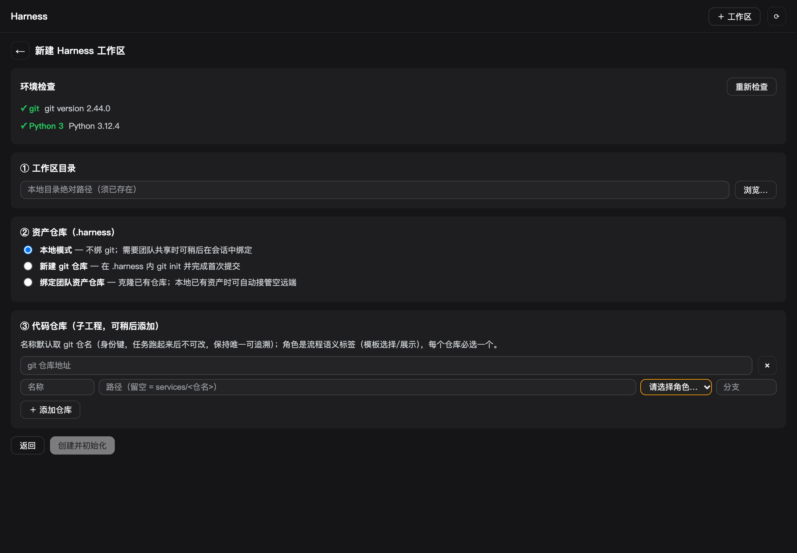
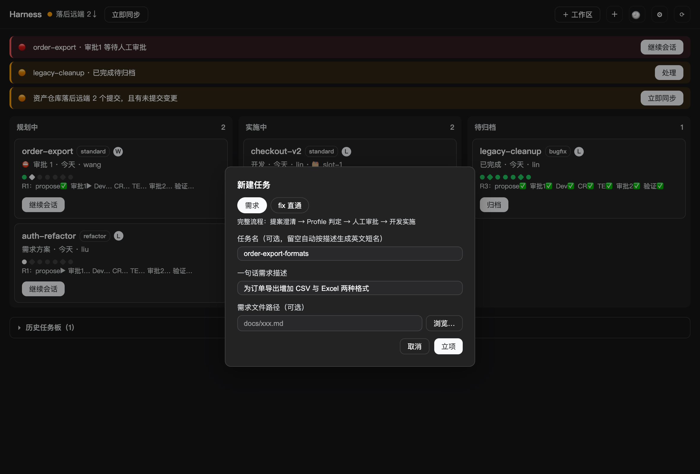
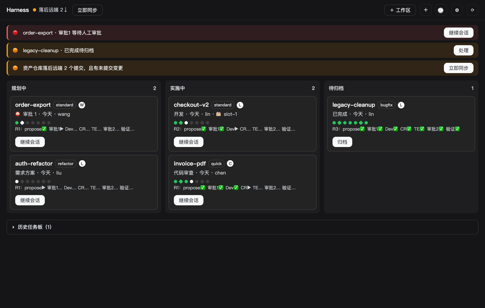

# Harness Kit

**把 AI 编程从个人手感，变成团队流程。**

Harness Kit 是 DeepSeek Harness 的多 Agent 工程流程插件：它把方案、开发、评审、测试拆给固定角色，在关键节点让人做审批，并把每一轮产物沉淀进你自己的 git 资产仓库。**AI 负责执行，人负责把关，资产持续沉淀。**

一个人用，它是你的项目记忆和第二双眼睛；一个团队用，它是共享的流程和资产。

`7 个角色` · `4 档流程` · `10 个命令` · `零运行时依赖` · `数据留在本地`

[English](README.md) | 简体中文

> Harness 是"挽具"：模型越强，越需要一套约束让它稳定输出，而不是每次都重新即兴发挥。

---

## 它先帮你把项目变成 AI 能读懂的样子

Harness Kit 不只是"加流程"。创建完成后点「启动初始化编排」，它会探测已登记的子工程，把 AI 每次都要重新摸索的项目知识补齐：

- 根目录 `AGENTS.md`，以及一行指针 `CLAUDE.md`
- 每个子工程的 `CLAUDE.md`（技术栈、模块入口）和 `docs/CODE_STANDARDS.md`（编码规范）
- `<子工程>/.harness/build.json`：编译、启动、测试命令
- `codebase-guide/`：模块级文档，按需加载，不占上下文
- 每个子工程的 `.codegraph/`：类、方法、调用链索引，AI 直接查，不必全量读代码
- `.harness/scripts`、`rules`、`templates`：看板、体检、规格校验与编码底线

生成前先给你一份计划确认；已存在的文件跳过，`build.json` 只补缺失键、不覆盖已有值。本机没有 CodeGraph 工具时脚本会尝试安装，也可以跳过。

---

## 三步上手（不用记命令）

### 1. 打开侧栏，新建工作区

侧栏打开 **Harness Kit** → 「＋ 工作区」→「新建工作区」：

- 选一个本地目录（可以是空目录）
- 选资产仓库：本地模式 / 新建 git 仓库 / 绑定团队 git 仓库
- 登记子工程（仓库地址、角色、分支），也可以稍后添加
- 点「创建并初始化」

向导会先做**环境检查**：缺 `git` 或 `Python 3` 时直接给出对应平台的安装命令，不用提交后才发现失败。初始化在后台执行，刷新页面不会中断，完成后面板给出报告；点「启动初始化编排」即可探测子工程并生成文档/索引（见上一节）。



### 2. 点「＋」立项

- 选「需求」或「fix 直通」
- 写一句话描述；任务名可以留空，自动生成英文短名
- 可选附一份需求文件

点「立项」后会自动打开一个**专属会话**开始执行：需求模式从 proposal 起草开始，fix 模式从缺陷文档与质量门开始。



### 3. 回到面板推进

- 任务卡片在「规划中 / 实施中 / 待归档」三列之间移动
- 「需要你」列出等你处理的事：审批、待归档、同步落后或冲突
- 点「继续会话」直达对应会话；处理完审批后自动接续下一阶段（默认开启，可在 `.harness/kit.json` 设 `autoAdvance: false` 关闭）
- 完成后归档，卡片进入底部「历史任务板」
- 🕘 看团队动态：谁在什么时候归档了什么
- ⚙ 配置：子工程基线分支、自动同步、模型映射



> 截图使用示例工作区（`acme-platform`），不是真实项目数据。

> **审批由人写下，面板只提醒、不代写**——审批 1 写进 `proposal.md`，质量门裁决写进 `bugfix.md`。这是刻意设计，防止审批流于形式。
>
> 面板覆盖日常操作；资产换绑、删除子工程、批量执行仍走命令（见下方速查）。

---

## 它和"个人 Vibe Coding"有什么不同

| 维度 | 个人 Vibe Coding | Harness Kit |
|---|---|---|
| 上下文 | 留在会话里，关掉就散 | 落进 `.harness/`，可 diff、可提交、可交接 |
| 质量 | 靠个人当时的审查状态 | 固定角色 + 审批点 + 工具护栏 |
| 协作 | 各开各的会话，靠口头同步 | 任务认领、并行 worktree、测试环境租约 |
| 模型 | 一个模型从头用到尾 | 角色/阶段级路由，强模型只用在关键处 |
| 审计 | 聊天记录 | 产物 + 审批标记 + git 历史 |
| 适用 | 一次性、探索性、短平快 | 需要稳定质量、反复迭代、可交接 |

Vibe Coding 的优势是"想到就写"，代价是把成本推给未来：返工、审查、上下文重建。Harness Kit 把一部分成本提前到规格和门禁上——**单文件小改会更慢，需要反复迭代、跨模块、隔一段时间再回来接手的活会更快。**

---

## 为什么值得用，哪怕只有你一个人

下面这些不要求你先有一个团队。一个人开发时，harness 解决的是"三个月后的你"、"换一台机器的你"、"下一次会话的你"：流程保证稳定，资产沉淀保证不用重讲。

### 审查成本：给自己第二双眼睛

AI 写得越快，需要看的越多。固定角色让 CR/TE 各自只做一件事，产出 `code-review.md`、`test-report.md`，审查有对象、有结论，而不是凭当天状态扫一眼。

### 交接成本：交接对象也可能是未来的你

上下文不在会话里，而在 `proposal.md`、`requirements.md`、`design.md` 里。隔一个月回来，或换一个人接手，读文件就能继续，不需要重新讲一遍背景。

### 一致性：不取决于当天的状态

四档流程 + 固定审批点，让"怎么做"成为可重复的流程，而不是个人习惯。角色和流程都是纯文件，项目可以在 `.harness/agents/`、`.harness/flows/` 里覆写。

### 并行：同时推进多个任务也不互相踩

看板认领、池化 worktree、测试环境串行租约，解决多个任务同时跑时最容易出的三类冲突：重复做、分支互相污染、抢测试环境。

### 模型成本：好钢用在刀刃上

方案和难审代码用强模型，样板任务用快模型；映射写在 `.harness/kit.json`，不绑死某个 provider。

### 资产沉淀：一个人用尤其明显

每跑完一轮，`specs/` 与 `memory/` 都会沉淀进资产仓库：这次的踩坑、上次的规格。**用得越久，资产越厚，下一次从零解释的成本越低。** 模板和规则也在 `.harness/` 里，可以按自己的习惯改写并提交。

### 数据与安全

插件本地运行，零运行时依赖、无安装脚本、不收集遥测；项目资产在你自己的 git 仓库里（共享时就是团队仓库）；模型请求只发往你配置的 provider。

---

## 它怎么工作

### 七个角色

| 角色 | 负责 | 典型产出 |
|---|---|---|
| Project Manager | 由当前会话 Lead 承担：编排、复核、推进审批与看板 | `proposal.md`、看板 |
| Business Analyst | 需求澄清与验收标准 | `requirements.md` |
| Solution Architect | 技术方案与影响面分析 | `design.md` |
| Readiness Reviewer | 方案就绪评审，给出 PASS / BLOCK | `readiness-report.md` |
| Developer | TDD 实施与自测 | 代码、`dev-log.md` |
| Code Reviewer | 代码审查，给出 PASS / 打回 | `code-review.md` |
| Test Engineer | 构建、单测、关键路径验证 | `test-report.md` |

### 四档流程

| 流程 | 适用 | 路径 |
|---|---|---|
| `standard` | 新功能、跨模块 | BA → SA → RR → 审批 1 → Dev → CR → TE → 审批 2 |
| `quick` | 小改动 | BA → SA（就绪自评）→ 审批 1 → Dev → CR → TE → 审批 2 |
| `bugfix` | 缺陷修复（全流程） | BA（`bugfix.md`）→ 审批 1 → Dev → CR → TE → 审批 2 |
| `refactor` | 重构、跨模块 | SA 影响面 → BA → SA → RR → 审批 1 → Dev → CR → TE → 审批 2 |
| `fix` 直通 | 轻量修复 | 质量门 → Dev →（`--full` 含 CR/TE；`--light` 只验证）→ 归档 |

### 审批点与护栏

- 审批 1：方案阶段结束，人决定是否进入开发
- 质量门：fix 直通由人裁决「轻量」或「--full」
- 审批 2：实施与测试结束，人决定是否归档
- 护栏：质量门未裁决时禁止写源码区；破坏性 git 命令（`reset --hard`、`clean -f`、`push --force`）直接拦截

### 资产仓库

`.harness/` 就是资产仓库的工作副本：

```
.harness/
├── kit.json              # 子工程、模型映射、资产仓库绑定
├── deliverables/         # 每轮交付物 + _archive/
├── specs/                # 能力规格，按轮次追加
├── memory/               # 踩坑记忆，一人一文件
├── tasks/                # 看板 + 本机状态（会话绑定、认领、worktree、测试环境租约）
├── agents/ flows/        # 项目级角色/流程覆写
└── scripts/ rules/       # 随插件版本刷新，不入资产仓库
```

### 并行与模型路由

- 池化 worktree：多个任务同时开发时，按仓库分配复用工作区，避免分支互相污染
- 测试环境租约：`/hk-te` 保证同一时间只有一个任务占用测试环境
- 模型路由：`kit.json` 把逻辑名（`reasoning` / `coding` / `fast` 或角色名）映射到具体 provider/model，未映射时回退会话默认

---

## 命令速查（进阶）

| 命令 | 作用 |
|---|---|
| `/hk-setup [--add <git-url>]` | 登记代码仓库到 `kit.json`，缺少的自动 clone |
| `/hk-init [--assets <url\|init\|local>]` | 初始化/刷新 `.harness/`，绑定资产仓库 |
| `/hk-new [<任务>] <描述> [--file <路径>]` | 启动全流程任务 |
| `/hk-propose <任务>` | 执行方案阶段 |
| `/hk-apply <任务> [反馈]` | 执行实施阶段 |
| `/hk-archive <任务>` | 归档本轮产物，执行 Spec/Memory Merge |
| `/hk-fix [<任务>] <描述> [--full\|--light]` | 轻量修复直通 |
| `/hk-te [acquire\|release <任务> \| status]` | 测试环境串行租约 |
| `/hk-sync` | 资产仓库同步（提交 → rebase → 追加合并 → push） |
| `/hk-doctor` | 工作区体检：kit、角色、规则、流程、脚本、看板、模型映射 |

---

## 安装

### 应用内（推荐）

**Plugins → Add plugin**，输入：

```
dsh-harness-kit@0.1.2
```

安装后启用 bundle。

### 命令行

```sh
dsh plugin --profile desktop add dsh-harness-kit@0.1.2
```

需要先完全退出 DSH Desktop；其他 profile 把 `desktop` 换成实际名称。

### 从源码

```sh
dsh plugin --profile desktop add /绝对路径/HarnessKit
```

### 要求

- DeepSeek Harness 0.2.x，带 Web 客户端（Desktop 或 `dsh web`）
- `git` 与 `Python 3`（向导会检查并给出安装命令）
- 一个 DSH 会话工作目录，作为 Harness 工作区

---

## 兼容性与已知限制

- 声明 DSH 范围 `>=0.2.0 <0.3.0`；DSH 0.3 发布后需要新的插件版本
- 面板是 Web 端功能；命令与护栏在加载 Host 插件的 profile 中可用
- 内置 `ai-coding` 内容包与面板文案以中文为主；角色/流程是纯文件，可按项目覆写
- 暂不支持 MCP 宿主（Claude Code / WorkBuddy 等），当前聚焦 DSH
- 面板不代写审批、不做资产换绑；这些操作保留在会话命令里

---

## FAQ

**会不会比直接让 AI 写更慢？**
单文件小改会；需要反复迭代、跨模块、隔一段时间再回来接手的活不会。它把返工和交接成本提前，而不是消灭。

**一个人有必要用吗？**
有。一个人最容易丢的是上下文和节奏：harness 把每轮的规格、踩坑和决策留在文件里，下次不用重新解释；CR/TE 角色相当于固定的第二遍审查；初始化补齐的 `CLAUDE.md`、`build.json`、`CodeGraph` 让 AI 不必每次重读整个项目。

**必须走完整流程吗？**
不用。四档流程 + `/hk-fix` 直通，可以先只用轻量档；流程档位在立项时确定。

**怎么共享？**
资产仓库就是 git。每个人在自己机器上有独立工作区，`.harness/` 绑定同一个资产仓库，靠 `/hk-sync` 或 git 同步。一个人用本地模式即可，绑定 git 是为了换机、备份和以后共享。

**数据去哪？**
项目资产在本地 `.harness/` 和你的 git（共享时就是团队仓库）；插件不收集、不上传遥测；模型请求只发往你配置的 provider。

**支持哪些宿主？**
当前只支持 DeepSeek Harness。MCP 宿主（Claude Code 等）尚未实现，文档不会假装支持。

---

## 开发

```sh
npm test              # mock agent 回归套件
npm run pack:check    # 打包并校验发布内容
```

Client 与面板改动仍需在真实 Web GUI 里手动验证。

## 参与与反馈

- 问题与建议：https://github.com/LaoLiang-agent/HarnessKit/issues
- 发布与维护流程见 [docs/PUBLISHING.md](docs/PUBLISHING.md)

## License

MIT © 2026 leo，见 [LICENSE](LICENSE)。
