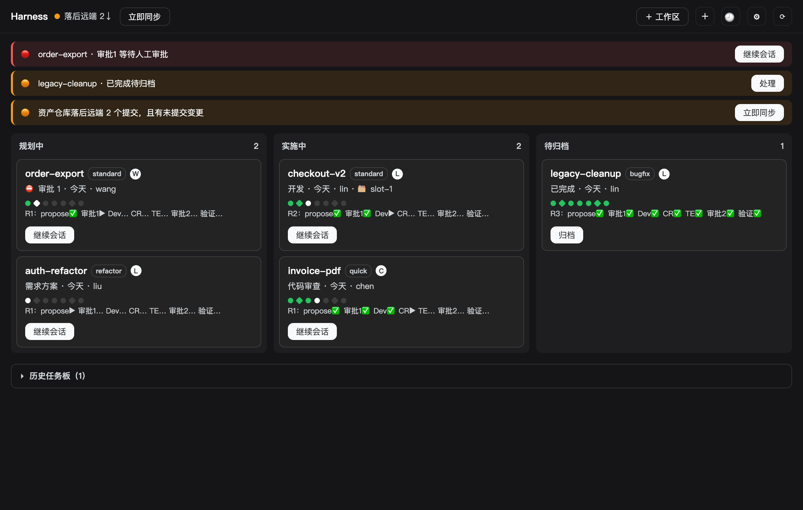

# Harness Kit

**Turn AI coding from a personal habit into a team process.**

Harness Kit splits analysis, design, implementation, review and testing across fixed roles, puts a
human at every approval point, and keeps each round's output in your own git asset repository.
AI executes, humans gate, assets accumulate.

Used alone, it is your project memory and a second pair of eyes. Used by a team, it is a shared
process and shared assets.

> A harness is a set of restraints: the stronger the model, the more it needs a stable process.

## It also fills in the project context

After the workspace exists, **Start initialization orchestration** probes the registered source
repositories and generates or fills in the root `AGENTS.md`, per-repository `AGENTS.md` (or legacy `CLAUDE.md`) and
`docs/CODE_STANDARDS.md`, `<repo>/.harness/build.json` (build, start and test commands),
`codebase-guide/` module docs and a `.codegraph/` index. Existing files are skipped, and you confirm
the plan before anything is written.

## Three steps in the UI

1. **Create a workspace**: Harness Kit → ＋ Workspace → New workspace. Pick a directory, an asset
   repository (local, new git, or team git) and source repositories, then create and initialize. The
   wizard checks `git` and `Python 3` first and shows install commands when something is missing.
   Initialization runs in the background and survives a refresh; then start the initialization
   orchestration to generate docs and indexes.
2. **Create a task**: ＋ → Requirement or Quick fix → one sentence (the task name can stay empty).
   A dedicated session opens automatically.
3. **Work from the panel**: cards move between Planning / Implementing / To archive. **Needs you**
   lists approvals, archives and sync problems; **Continue session** jumps to the task session.
   Archived work moves to the history board; 🕘 opens Team; ⚙ opens Workspace (source branches,
   auto-sync and model mappings).

Approvals are written by a human (`proposal.md` for approval 1, `bugfix.md` for the quality gate);
the panel only reminds. Asset rebinding and removing source repositories stay in commands.

The screenshot uses a sample workspace (`acme-platform`), not real project data.

## Vibe coding vs Harness Kit

| | Personal vibe coding | Harness Kit |
|---|---|---|
| Context | In one session, gone when it closes | Under `.harness/`, diffable and handover-ready |
| Quality | The individual's review at that moment | Fixed roles + approval gates + guards |
| Collaboration | Separate sessions, verbal sync | Claims, parallel worktrees, test-environment lease |
| Models | One model throughout | Role/stage routing |
| Audit | Chat history | Artifacts + approval markers + git history |

A one-file change is slower; iterative, cross-module work that you return to weeks later is faster.

## Roles and flows

Seven roles: Project Manager (the session Lead), Business Analyst (`requirements.md`), Solution
Architect (`design.md`), Readiness Reviewer (`readiness-report.md`), Developer (code and
`dev-log.md`), Code Reviewer (`code-review.md`), Test Engineer (`test-report.md`).

Four profiles plus the `fix` shortcut:

- `standard`: BA → SA → RR → approval 1 → Dev → CR → TE → approval 2
- `quick`: small changes, with a self readiness check
- `bugfix`: full defect-fix flow
- `refactor`: blast-radius analysis first
- `fix` (quick fix): quality gate → Dev → (`--full` adds CR/TE, `--light` verifies only) → archive

Source writes are blocked until the quality gate is recorded; `reset --hard`, `clean -f` and
`push --force` are rejected.

## Closeout and run records

Four daily entries cover the workflow: `/hk init`, `/hk task`, `/hk close`, `/hk doctor`. Existing
`/hk-*` commands remain as advanced aliases.

`/hk close` enables `worktree.autoClose` by default for new workspaces. It aligns the local target
with `origin` according to `targetSync` (default `safe`, local only), merges a clean task branch
locally, releases the slot and deletes the merged task branch. It never pushes. Conflicts, a dirty
target or a diverged target stop before archiving, leaving the task active. `--no-merge` archives
documents only; `--dry-run` previews.

Each archive writes `.harness/deliverables/_archive/<task>/metrics/R<N>.json` with the actual
provider/model/reasoning effort, turns, token components, active duration, tool failures and
coverage. The panel's run record uses the same collector. Only metadata is stored: no prompts,
message bodies or raw session ids. Historical tasks are not backfilled.

## Assets accumulate

`.harness/` is the working copy of the asset repository: `kit.json`, `deliverables/`, `specs/`,
`memory/`, `tasks/` (board and shared claims), `local/` (machine-local state), and project-level
`agents/ flows/`. Every round settles specs and lessons; used solo this matters most, because the
longer you use it, the thicker the assets and the less the next session has to re-explain. Templates
and rules also live under `.harness/` and can be adapted and committed per team.

`.harness/local/` holds session bindings, the worktree ledger, decisions, the test lease and local
config approvals; the whole directory is ignored. Legacy `tasks/*.json` files migrate automatically
on first read or `/hk init`.

## Requirements

- DeepSeek Harness 0.2.x with the Web client
- `git` and `Python 3` (the wizard checks and shows install commands)
- A DSH session working directory as the Harness workspace

## Compatibility and limits

- DSH `>=0.2.0 <0.3.0`; 0.3 needs a new release
- The panel is a Web feature; commands and guards work in any profile that loads the Host plugin
- The bundled content pack and panel text are Chinese-first; roles and flows are overridable
- No MCP host support yet
- The panel does not write approvals or rebind asset repositories

## Data

The plugin runs locally with zero runtime dependencies, no install scripts and no telemetry. Project
assets live in your team's git; model requests go only to the provider you configure.
