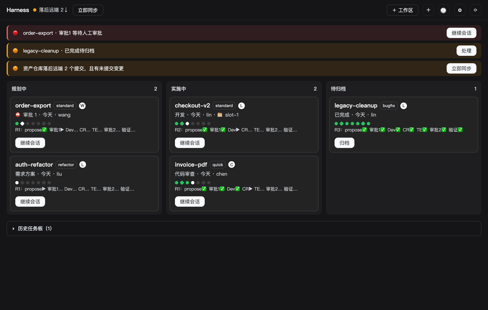

# Harness Kit

**把 AI 编程从个人手感，变成团队流程。**

Harness Kit 把方案、开发、评审、测试拆给固定角色，在关键节点让人做审批，并把每一轮产物沉淀进你自己的 git 资产仓库。AI 负责执行，人负责把关，资产持续沉淀。

一个人用，它是你的项目记忆和第二双眼睛；一个团队用，它是共享的流程和资产。

> Harness 是"挽具"：模型越强，越需要一套约束让它稳定输出。

## 它还会补齐项目上下文

创建完成后点「启动初始化编排」，它会探测已登记的子工程，生成/补齐根 `AGENTS.md`、子工程 `AGENTS.md`（已有 `CLAUDE.md` 则跳过）、`docs/CODE_STANDARDS.md`、`<子工程>/.harness/build.json`（构建/启动/测试命令）、`codebase-guide/` 模块文档与 `.codegraph/` 索引；已有文件跳过，生成前先给计划确认。

## 三步上手（界面）

1. **新建工作区**：侧栏 Harness Kit →「＋ 工作区」→「新建工作区」，选目录、资产仓库、子工程，点「创建并初始化」。向导先检查 `git` / `Python 3`，缺失时直接给出安装命令；初始化在后台执行，刷新页面不中断，完成后可启动初始化编排生成文档与索引。
2. **立项**：顶部「＋」→「需求」或「快速修复」→ 一句话描述（任务名可留空）；可多选工作区文件/图片/整个原型目录或从本机上传，统一拷入任务 `inputs/`；也可按仓选择开发基线（同时作为分析基点和归档合入目标）。立项后自动打开专属会话。
3. **推进**：任务卡片在「规划中 / 实施中 / 待归档」之间移动；「需要你」提醒审批、归档、同步；点「继续会话」处理。归档后进历史任务板；🕘 团队；⚙ 工作区（分支、自动同步、模型映射：团队默认/本机覆盖）。

审批由人写下（`proposal.md` 的「审批 1：通过」、`bugfix.md` 的质量门裁决），面板只提醒、不代写。资产换绑与删除子工程仍走命令。

截图使用示例工作区（`acme-platform`），不是真实项目数据。

## 与个人 Vibe Coding 的区别

| | 个人 Vibe Coding | Harness Kit |
|---|---|---|
| 上下文 | 留在会话里，关掉就散 | 落进 `.harness/`，可 diff、可交接 |
| 质量 | 靠个人当场审查 | 固定角色 + 审批点 + 工具护栏 |
| 协作 | 各开各的会话 | 任务认领、并行 worktree、测试环境租约 |
| 模型 | 一个模型全程 | 角色/阶段路由 |
| 审计 | 聊天记录 | 产物 + 审批标记 + git 历史 |

单文件小改会更慢；需要反复迭代、跨模块、隔一段时间再回来接手的活更快。

## 七个角色

Project Manager（当前会话 Lead，编排与看板）、Business Analyst（`requirements.md`）、Solution Architect（`design.md`）、Readiness Reviewer（`readiness-report.md`）、Developer（代码 + `dev-log.md`）、Code Reviewer（`code-review.md`）、Test Engineer（`test-report.md`）。

## 四档流程

- `standard`：BA → SA → RR → 审批 1 → Dev → CR → TE → 审批 2
- `quick`：小改动，SA 做就绪自评
- `bugfix`：缺陷修复全流程
- `refactor`：SA 先做影响面分析
- `fix` 快速修复：质量门 → Dev →（`--full` 含 CR/TE，`--light` 只验证）→ 归档

质量门未裁决时禁止写源码区；`reset --hard`、`clean -f`、`push --force` 直接拦截。

## 收尾与运行统计

四个日常入口是 `/hk init`、`/hk task`、`/hk close`、`/hk doctor`；旧 `/hk-*` 命令保留为高级别名。

`/hk close` 默认开启 `worktree.autoClose`（新工作区默认）：先按 `targetSync`（默认 `safe`，只做本地同步）把本地目标对齐 `origin`，再把干净任务分支本地合入、释放 slot 并删除任务分支。不会自动 push；冲突、目标脏或分叉会在归档前停下，任务保持活跃。`--no-merge` 只归档文档，`--dry-run` 只预演。

每次归档会在 `.harness/deliverables/_archive/<任务>/metrics/R<N>.json` 留下本轮统计：实际 provider/model/推理等级、轮次、token 分项、活动耗时、工具失败与覆盖率。面板的「查看运行记录」使用同一采集函数；只收元数据，不记录 prompt、消息正文或原始 session id。历史任务没有自动补录。

## 资产沉淀

`.harness/` 是资产仓库的工作副本：`kit.json`、`deliverables/`、`specs/`、`memory/`、`tasks/`（看板与共享认领）、`local/`（本机状态）、项目级 `agents/ flows/`。每跑完一轮，规格与踩坑记忆都会沉淀下来；一个人用尤其明显：用得越久，资产越厚，下一次从零解释的成本越低。模板和规则也在 `.harness/` 里，可按团队习惯改写并提交。

`.harness/local/` 存放会话绑定、worktree 台账、决策点、TE 租约、本机配置确认和 Worker 模型本机覆盖（`models.json`）等本机状态，整体被 `.gitignore` 排除；旧 `tasks/*.json` 会在首次读取或 `/hk init` 时自动迁移。团队默认模型映射仍在 `kit.json`，本机覆盖优先且不共享。

## 要求

- DeepSeek Harness 0.2.x，带 Web 客户端
- `git` 与 `Python 3`（向导会检查并给出安装命令）
- 一个 DSH 会话工作目录作为 Harness 工作区

## 兼容与限制

- DSH 范围 `>=0.2.0 <0.3.0`，0.3 需要新版本
- 面板为 Web 端功能；命令与护栏在加载 Host 插件的 profile 中可用
- 内置内容包与面板文案以中文为主，角色/流程可按项目覆写
- 暂不支持 MCP 宿主
- 面板不代写审批、不做资产换绑

## 数据

插件本地运行，零运行时依赖、无安装脚本、不收集遥测；项目资产在团队自己的 git 仓库；模型请求只发往你配置的 provider。
